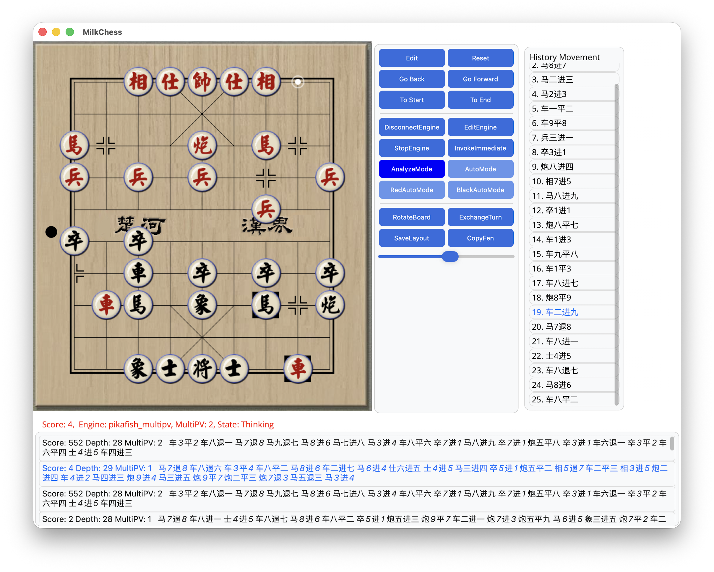
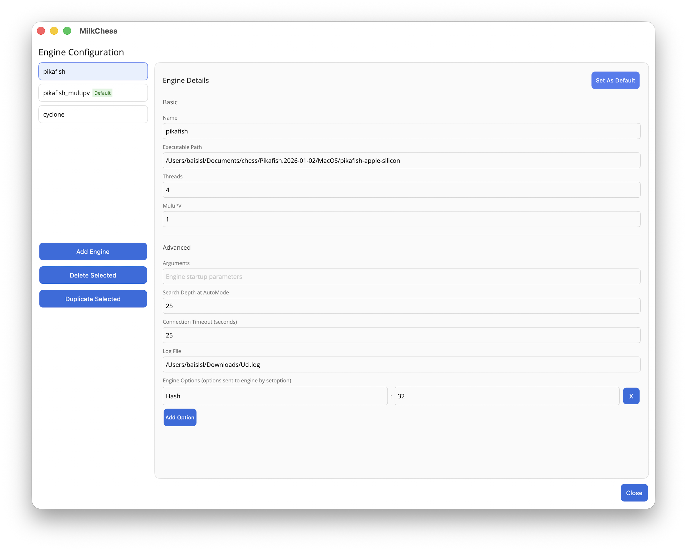

# MilkChess Xiangqi GUI


A lightweight **Chinese Chess (Xiangqi) GUI for macOS**, designed for playing and analyzing games with uci engines such as Pikafish and Xuanfeng.

一个轻量化的 **macOS 中国象棋 GUI**，支持接入外部象棋引擎（如 Pikafish、旋风）进行对弈与分析。

## Features | 功能

- **Engine Support** — Support multiple engines with MultiPV analysis  
  **引擎支持** — 支持不同引擎选择，手动设定MultiPV/Threads等引擎参数

- **Position Editing** — Full FEN support with board editing tools  
  **局面编辑** — 支持 FEN 格式并可自由编辑棋盘局面

- **Game History Navigation** — Jump through move history and predicted lines  
  **棋局历史浏览** — 支持历史跳转与引擎预测局面查看

## Screenshots




## Supported Engines

Engines following **UCI protocol** should work. Tested with:
- Pikafish
- Xuanfeng  

## Build

This project is built with **.NET MAUI**.

Requirements:

- .NET SDK 8.0
- MAUI workload installed
    - maui-maccatalyst 8.0.100

Build from source:

```shell
git clone git@github.com:baislsl/MilkChess.git
cd MilkChess/MilkChess/
dotnet build -t:Run -f net8.0-maccatalyst

# release build:
# dotnet publish -c Release -f net8.0-maccatalyst
```


## License

This project is licensed under the **GNU GPL v3.0** license.

You are free to use, modify and distribute this software under the terms of the GPLv3.
